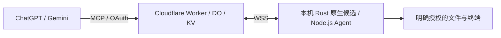

# Chat2Local

让 ChatGPT、Gemini 等支持自定义 MCP 的应用，访问你明确授权的电脑目录。一个实例连接多台电脑，每个应用和每台电脑分别管理权限。

[首次配对](#1-首次配对) · [回连](#2-回连) · [多设备连接](#3-多设备连接) · [管理](#4-管理)

## 1. 首次配对

准备自己的 Cloudflare 账号，以及能添加自定义 MCP 服务的应用账号。各应用的账号、地区及功能开放条件以其当前界面为准。

在仓库选择 **Code → Download ZIP**，解压后打开终端。普通安装器仍使用 Node.js Agent；[已发布的 0.1.0-alpha.28 安装包](https://github.com/jianmosier/chat2local/releases/tag/v0.1.0-alpha.28) 不会因源码更新自动变成 Rust 版本。

Windows PowerShell：

    .\install.ps1

macOS 终端：

    sh install.sh

按提示登录 Cloudflare，创建自己的实例，将提供的 /mcp 地址添加到 ChatGPT 或 Gemini，再在本机核对请求应用、电脑、目录和权限后确认。首次连接需要在运行 Agent 的电脑上完成本地确认。

Windows Rust 原生 Agent 已在现有授权数据上完成实际使用：Gemini 项目文件读写、ChatGPT 设备和目录查询。它仍是部分功能的原生候选，尚未提供新的预编译 Release；构建入口见下方开发说明。

## 2. 回连

日常打开已安装的 Chat2Local 启动入口。Windows 可按 **Win + R**，输入 %LOCALAPPDATA%\Chat2Local\Chat2Local.cmd；macOS 打开用户 Applications 里的 Chat2Local.command。

Agent 运行期间主动通过 WSS 连接云端，网络恢复后自动回连。关闭管理网页不会停止 Agent。应用提示授权过期时，先在原连接中重新认证；不要清空设备身份或复制密钥。

若浏览器跳到 127.0.0.1 却拒绝连接，先启动本机 Agent。更新或重启后，管理页要求验证时通过本机启动入口重新打开。

开始任务前，让 AI 实际调用 list_devices 和 list_roots，确认电脑、目录及权限。例如：“读取指定电脑上已共享项目的 README，解释结构，不修改文件。”

## 3. 多设备连接

在管理页的“连接与新电脑”复制安装链接，到另一台电脑安装，输入实例安装密码并单独选择共享目录。继续使用原应用连接，不要求旧电脑在线，也不复制设备密钥。

多台电脑在线时明确指定目标；目标离线不会改到另一台执行。ChatGPT 与 Gemini 分别持有目录共享范围，一个应用能访问，不代表另一个应用自动获得相同权限。

终端执行同时需要应用的终端 OAuth 权限和本机目录的终端许可。普通文件共享默认只新增文件读写权限，执行命令需要单独选择并确认。

## 4. 管理

打开本机启动入口。Rust 原生面板的“授权一个本机目录”只保存本机允许的目录；还需点 **“共享给应用”**，选择 Gemini、ChatGPT 等具体连接，再添加目标目录并确认。

共享窗口默认“文件读写”；“文件读写和执行命令”是单独的选择。已有目录可设置只读、逐次审批或直接读写。移除共享保留磁盘文件；父子目录重叠时，确认页列出实际撤销范围。

文件工具支持不超过 64 KiB 的 UTF-8 文本，覆盖前检查哈希并保留备份；不提供删除文件和二进制传输。结果为 pending、failed 或 unknown 时，先查询原操作状态，不要重复提交。

**终端不是操作系统沙箱**：命令以当前系统用户权限运行，可访问共享目录以外的文件和网络。终端操作没有自动备份，取消任务不会回滚已发生的修改。

云端实例与本机客户端分别更新。内容经自己的实例与所选 AI 应用处理。普通更新应保留原域名、存储、设备身份和已有权限。

开发者：Rust 状态、构建与源码

本机 Windows 原生候选包含连接与重连、文件操作、审批历史、终端、平台适配及本地授权管理，沿用原设置和 CurrentUser DPAPI 数据。fullAgent=false、upgradeReady=false；通用设备注册、配对码和断开身份入口尚未覆盖。网页仍是 HTML / CSS / JavaScript，内嵌在原生程序中。

云端 Rust Device、Registry、OAuth 和 OIDC 模块是独立构建候选。本机读写成功不代表完整云端 Rust 部署。默认 Worker 和普通安装器仍走现有 JavaScript 路径；原生程序通过自己的入口启动。

crates/ 是 Rust 工作区；src/agent/ 保留 Node.js 兼容实现；src/relay/ 是网关及 Rust 模块适配；scripts/ 包含构建、校验和公开导出工具。

开发环境：Node.js 24.14–26。原生构建还需要 Rust MSVC 工具链、Visual Studio C++ 开发环境，以及已校验的 OpenSSL 3.5.8 静态产物。

    npm ci --ignore-scripts
    npm run check

在 Windows C++ 开发环境中，将 CHAT2LOCAL_OPENSSL_DIR、CHAT2LOCAL_OPENSSL_MANIFEST、CHAT2LOCAL_OPENSSL_MANIFEST_SHA256 分别指向自己的安装目录、逐文件 SHA-256 JSON 清单及清单自身的 SHA-256。清单中的 install/ 必须与安装目录对应，至少包含头文件、libssl.lib、libcrypto.lib 和 openssl.exe；构建器会校验所有列出的文件。

    node scripts/build-native-agent.mjs --openssl-dir "$env:CHAT2LOCAL_OPENSSL_DIR" --openssl-manifest "$env:CHAT2LOCAL_OPENSSL_MANIFEST" --openssl-manifest-sha256 "$env:CHAT2LOCAL_OPENSSL_MANIFEST_SHA256"
    .\.artifacts\native-agent\chat2local-native-agent.exe --launch

使用原 Windows 用户和原状态目录，先正常停止旧 Agent，避免同时运行两个宿主。不要为切换原生程序删除授权数据。npm start 仍启动 Node.js 兼容入口。

npm run build:public 只导出清单中的公开文本源码，排除个人配置、设备身份、构建缓存和私人交接。npm run release 是另一项发布操作；源码同步不等于生成新安装包或更新云端。

0.1.0-alpha.28 · [MIT License](LICENSE)
