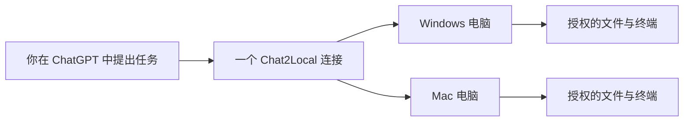
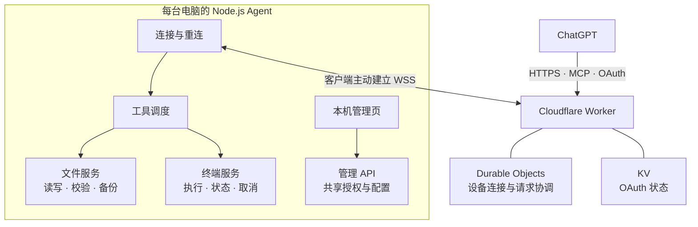

# Chat2Local

**让 ChatGPT 直接使用你授权的电脑文件和终端。**

一个连接，多台电脑。读项目、改代码、运行测试，无需来回复制内容。

[项目概览](#1-项目概览) · [技术架构](#2-技术架构) · [安装与使用](#3-安装与使用) · [功能](#4-功能) · [管理页](#5-管理页)

## 1. 项目概览

Chat2Local 把你选择的本地文件夹接入 ChatGPT。你在聊天中提出任务，电脑上的客户端执行操作并返回结果。



每台电脑独立授权，使用同一套管理界面。电脑需要联网，但不必处于同一局域网。

## 2. 技术架构

由 **ChatGPT 连接、自建云端实例、本机 Agent** 三部分组成。云端负责认证和转发，Agent 负责实际的文件读写与命令执行。



**技术选型：** JavaScript ES Modules、Node.js、Cloudflare Workers / Durable Objects / KV、MCP、OAuth。管理页使用 HTML / CSS / JavaScript；终端通过 `child_process.spawn` 启动 PowerShell 或 sh。

客户端主动连接云端，无需开放电脑的入站端口。管理页只监听 `127.0.0.1`，每台电脑直接连接自己的云端实例，不经过其他电脑中转。

<details>
<summary>开发者：源码结构与运行</summary>

```text
src/
  agent/
    main.mjs                 服务组装、启动与关闭
    bridge.mjs               云端通信与重连
    runtime/
      tool-dispatcher.mjs    文件与终端工具调度
      serial-queue.mjs       操作与权限变更的有界队列
      agent-state.mjs        本机配置、身份与运行状态
      http-router.mjs        管理 API 路由与请求认证
      controller-actions.mjs 本机管理操作
    files.mjs                文件工具入口
    files/                   文件权限、路径检查、读写备份、操作记录
    terminal.mjs             终端工具入口
    terminal/                终端权限、系统 Shell、进程管理、任务记录
    ui/                      本机管理界面
  relay/                     云端认证、设备路由与安装入口
  shared/                    两端共用的协议与权限契约
scripts/                     安装、构建与发布
tests/                       单元、HTTP 集成与浏览器测试
```

开发环境：Node.js 24.14–26；浏览器测试使用 Microsoft Edge。

```sh
npm ci --ignore-scripts
npm run verify
```

`npm run build:public` 导出公开源码；`npm run release` 构建发布包，添加 `--publish` 和目标仓库参数后发布。个人配置、凭据和日志不进入公开源码包。

</details>

## 3. 安装与使用

### 首台电脑

准备自己的 Cloudflare 账号，以及支持自定义 MCP 连接的 ChatGPT 账号或工作区。云端资源由你自己的账号管理。

在本仓库选择 **Code → Download ZIP**，解压后，在该目录打开终端并运行：

**Windows · PowerShell**

```powershell
.\install.ps1
```

**macOS · 终端**

```sh
sh install.sh
```

安装器自带运行环境，无需预装 Node.js 或 Git。使用普通系统用户运行，不使用管理员终端或 `sudo`。

随后按提示完成：

1. 登录 Cloudflare，确认创建自己的云端实例。
2. 在 ChatGPT 添加安装器提供的 `/mcp` 地址，并完成授权。
3. 选择本机共享文件夹，设置供新电脑加入使用的实例安装密码。

### 添加其他电脑

在管理页展开 **连接与新电脑**，点击 **复制安装链接**，到新电脑打开。按页面提供的命令安装，输入实例安装密码，再选择这台电脑的共享文件夹。

继续使用原 ChatGPT 连接；旧电脑不必在线，也不需要复制设备密钥。

### 开始使用

在 ChatGPT 中指定电脑、文件夹和任务，例如：

> 列出我的电脑和共享目录。读取工作电脑上的项目，解释代码结构，不修改文件。

> 在指定项目中修复这个问题，运行测试，汇报改动和结果。

## 4. 功能

| 能力 | 用途 |
| --- | --- |
| 文件操作 | 浏览目录、读取文本、创建和修改文件 |
| 终端执行 | 运行命令、查看输出、查询状态、取消任务 |
| 多设备连接 | 通过一个 ChatGPT 连接使用多台电脑 |
| 权限与维护 | 管理共享范围、自动重连、登录自启与客户端更新 |

**文件操作：** 支持不超过 64 KiB 的 UTF-8 文本。修改时校验文件哈希，覆盖前备份；可选择直接读写或逐次确认。文件工具不提供删除和二进制传输。

**终端执行：** 本机命令许可和 ChatGPT 终端授权均生效后，才能执行命令。支持 Windows PowerShell 和 macOS sh。执行结果不明时，先查询原任务状态，避免重复执行。

**多设备连接：** 每台电脑保存独立身份与权限。多台电脑在线时明确指定目标；目标离线不会改到另一台执行。客户端运行期间，网络恢复后自动重连。

**权限与维护：** 在管理页添加或移除共享目录、检查权限、设置登录自启和获取更新命令。新增授权需确认，已有权限不会因更新自动扩大。

## 5. 管理页

打开本机的 **Chat2Local 启动入口**，日常操作都在这个页面完成。

| 区域 | 操作 |
| --- | --- |
| 顶部状态 | 查看当前电脑与连接状态 |
| 共享文件夹 | 添加目录、检查权限、升级授权、移除共享 |
| 连接与新电脑 | 复制 ChatGPT 连接地址或新电脑安装链接 |
| 更新与启动 | 设置登录自启、复制更新命令 |
| 连接详情 | 查看实例、终端权限、版本与最近同步时间 |

**更新客户端：** 点击“复制更新命令”，在本机 PowerShell 或终端运行。需要查看内容时展开“查看更新命令”。更新保留原有设备身份和共享设置。

**移除共享：** 只撤销访问权限，不删除磁盘文件。父子目录重叠时，确认框列出实际撤销范围。

**重新打开管理页：** 在“更新与启动 → 找不到启动入口”查看本机打开方式。Windows 也可按 **Win + R**，输入 `%LOCALAPPDATA%\Chat2Local\Chat2Local.cmd`；macOS 打开用户 Applications 文件夹中的 `Chat2Local.command`。

### 使用须知

终端不是操作系统沙箱：命令以当前系统用户权限运行，可访问共享目录以外的文件；终端操作不提供自动备份，取消任务不会回滚已发生的修改。

传输内容经过自建云端实例和 ChatGPT 处理。关闭管理网页不会停止客户端；云端实例与客户端分别更新。

---

**0.1.0-alpha.28 · MIT License**
